<picture><source media="(prefers-color-scheme: dark)" srcset="assets/hero-dark.svg"></picture>

<picture><source media="(prefers-color-scheme: dark)" srcset="assets/about-dark.svg"></picture>

<picture><source media="(prefers-color-scheme: dark)" srcset="assets/stack-dark.svg"></picture>

<a href="https://github.com/wirosmango/sway-dotfiles"><picture><source media="(prefers-color-scheme: dark)" srcset="assets/project-sway-dotfiles-dark.svg"></picture></a>&nbsp;<a href="https://github.com/wirosmango/huegrad-site"><picture><source media="(prefers-color-scheme: dark)" srcset="assets/project-huegrad-site-dark.svg"></picture></a>

<a href="https://github.com/wirosmango/huegrad-android"><picture><source media="(prefers-color-scheme: dark)" srcset="assets/project-huegrad-android-dark.svg"></picture></a>&nbsp;<a href="https://github.com/wirosmango/i3wm-dotfiles"><picture><source media="(prefers-color-scheme: dark)" srcset="assets/project-i3wm-dotfiles-dark.svg"></picture></a>

<picture><source media="(prefers-color-scheme: dark)" srcset="assets/stats-dark.svg"></picture>

<picture><source media="(prefers-color-scheme: dark)" srcset="assets/streak-dark.svg"></picture>

<picture><source media="(prefers-color-scheme: dark)" srcset="assets/wave-dark.svg"></picture>

<a href="https://example.com"><picture><source media="(prefers-color-scheme: dark)" srcset="assets/button-1-dark.svg"></picture></a>&nbsp;&nbsp;<a href="https://github.com/wirosmango?tab=repositories"><picture><source media="(prefers-color-scheme: dark)" srcset="assets/button-2-dark.svg"></picture></a>

<a href="https://metawka.github.io/expressive-profile/?from=wirosmango"><picture><source media="(prefers-color-scheme: dark)" srcset="assets/credit-dark.svg"></picture></a>

